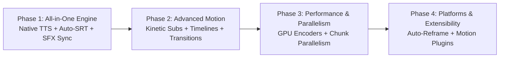

# AgentCut Upgrade Roadmap

This document outlines the strategic roadmap for expanding AgentCut from an agent-first video compositor into an **autonomous, end-to-end AI video creation studio**.

---

## 🗺️ The 4 Strategic Phases

---

### Phase 1: All-in-One Creation Engine (Completed ✅)
**Goal:** Enable autonomous end-to-end video generation directly from text briefs without requiring external tools for voice synthesis or caption timing.

1. **Native Text-to-Speech (TTS) Integration (`agentcut.tts`):**
   * Built-in support for Edge-TTS (multilingual, high quality, zero cost) and pluggable cloud providers (ElevenLabs, Azure Speech).
   * Briefs can now supply `narration_text` directly within scenes instead of requiring pre-recorded audio files.
2. **Auto SRT & Subtitle Word Timing:**
   * Automatic generation of time-aligned SRT captions directly during TTS synthesis.
   * Full RTL and BiDi shaping support preserved across all platforms.
3. **Procedural Sound Design & Auto-Foley (`agentcut.audio` / SFX):**
   * Light built-in sound effects (whoosh, pop, click, swoosh) synced to motion graphic entrance and transition events.
   * Procedural background ambient audio synthesis when no music file is supplied.
4. **Enhanced MCP Tools & CLI:**
   * Direct prompt-to-video workflow exposed via MCP tools and CLI commands.

---

### Phase 2: Advanced Motion Graphics & Dynamic Typography (Completed ✅)
**Goal:** Elevate visual production value to match modern short-form (Reels/TikTok/Shorts) and explainer video aesthetics.

1. **Kinetic Typography (Karaoke Highlighting):**
   * Dynamic word-by-word subtitle highlighting synchronized with speech audio via `boundary="WordBoundary"` and unified ASS styles.
2. **Expanded Diagram Templates:**
   * `timeline`: Chronological and roadmap diagrams with progressive draw-on animation.
   * `process_flow`: Step-by-step workflow animations with connecting arrows and node badges.
3. **Cinematic Transitions:**
   * Explainer scene transitions support `whip_pan`, `glitch`, `cross_zoom`, `light_leak`, `zoom_out`.

---

### Phase 3: Hardware Acceleration & Parallel Rendering (Completed ✅)
**Goal:** 60-80% rendering speed improvement and scalable production throughput.

1. **GPU Hardware Acceleration:**
   * Automatic detection and fallback for `h264_nvenc` (NVIDIA), `h264_videotoolbox` (Apple Silicon), `h264_qsv` (Intel), `h264_amf` (AMD), `h264_mf` (Windows Media Foundation), `h264_vaapi` (Linux).
2. **Chunked Parallel Scene Rendering:**
   * Render independent scenes concurrently across CPU/GPU cores, concatenated via FFmpeg concat demuxer (`-c copy`).
3. **Ultra-Fast Draft Mode:**
   * 2-second preview generation at low resolution for agent verification loops.

---

### Phase 4: Platform Adaptation & Extensibility (Completed ✅)
**Goal:** Seamless multi-platform distribution and community-driven expansion.

1. **Smart Multi-Aspect Auto-Reframe (`agentcut.reframe`):**
   * Intelligent transformation between 16:9 (Landscape), 9:16 (Vertical Shorts/Reels/TikTok), 1:1 (Square), and 4:5 (Social Portrait).
   * Industry-standard `blur_pad` mode (dynamic blurred background padding), `crop` mode, and `fit` letterboxing.
   * Multi-variant generation in a single call (`reframe_to_variants`).
2. **Plugin Architecture for Motion & Diagrams (`agentcut.plugins`):**
   * Decoupled plugin registry for motion elements (`MotionPlugin`) and diagram templates.
   * Dynamic loading from workspace `./plugins/` or user `~/.agentcut/plugins/`.
   * Standard reference plugins included: `progress_bar` and `badge`.
3. **Interactive Local Web Studio (`agentcut.studio`):**
   * Single-page, zero-dependency HTML5 timeline inspector and synchronized video player.
   * Multi-track visualization (Scenes, Narration, Motion, Audio bed), live playhead scrubber, aspect ratio frame simulator, and scene inspector.
4. **New CLI Subcommands & MCP Tools:**
   * CLI: `reframe`, `studio`, `plugins`.
   * MCP Tools: `reframe_video`, `generate_web_studio`, `list_plugins`.
